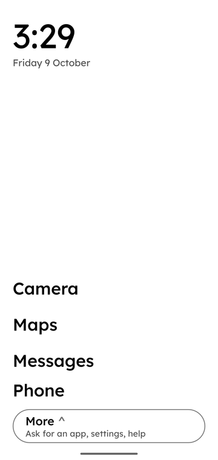
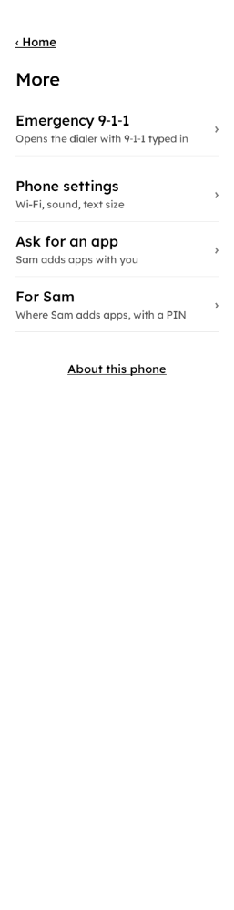
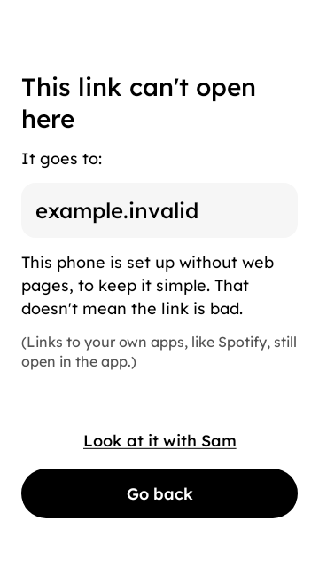

# Own Phone

**A calm Android phone that only runs the apps you chose, with someone you trust holding the key.**

Own Phone is an open-source "focused phone" layer for ordinary Android phones, in the spirit of Wisephone. It is still being built, so this describes what it is designed to do. You won't flash a new operating system. You install one app on a freshly reset, stock Android phone, and that app becomes the phone's manager and its home screen. Once it is finished:

- the home screen is a short list of app names in large black text, with no icons, badges or colour;
- every app that hasn't been added is hidden, apart from the parts of Android that calls, texts and emergency calls depend on;
- calls, texts and 9-1-1 are designed to stay available: no lock, check or wait in Own Phone stands in their way;
- adding an app needs a **trusted person** (a spouse, a friend, a family member) to type their PIN on the phone, with the phone in their hands. On a self-managed phone, the user types their own PIN and waits.

<p align="center">
  
  &nbsp;
  
  &nbsp;
  
</p>

<sub>Left: the preview-2 test build running as the phone's manager on an Android 15 emulator. Middle and right: the More page and the blocked-link screen, rendered by the screenshot tests in `app/ui`. "Sam" is a sample trusted person.</sub>

> **Status: early and not ready for anyone's daily phone.** The MVP (the first small version that works end to end) is being built in the open. Test builds run on emulators and on one spare test phone. See [Where things stand](#where-things-stand).

## Contents

- [Who it's for](#who-its-for)
- [How it works](#how-it-works)
- [The custody contract](#the-custody-contract)
- [What Own Phone can't do](#what-own-phone-cant-do)
- [Where things stand](#where-things-stand)
- [What's in this repo](#whats-in-this-repo)
- [Architecture](#architecture)
- [Build it and run it on an emulator](#build-it-and-run-it-on-an-emulator)
- [Contributing](#contributing)
- [Licence](#licence)

## Who it's for

Own Phone is for adults who want a simpler phone and have chosen one for themselves, and for the person they trust to help them keep it that way. That might be:

- someone who wants their phone back as a tool, not a feed;
- a couple who each hold the key to the other's phone;
- an older parent who wants calls, texts, photos and maps, and nothing that confuses them;
- someone who wants friction without a second person: **self-managed mode** adds waits and limits instead of a trusted person. It is honest about being friction, not a lock.

It is designed for people who are **not** phone tinkerers. Every screen is written in plain words and checked at Android's largest text size (200%). Nobody using it should ever need to know what "Device Owner" means.

There are two kinds of user, and Own Phone designs for both:

| | The person using the phone | The trusted person |
|---|---|---|
| What they want | A calm phone that does the basics without thinking, a clear way to ask for things, and never to feel watched | To say yes or no to apps, with the phone in their hands, and to know honestly what they can't control |
| What they see | Home, More, "Ask for an app", "About this phone" | A PIN-protected area under More, used only on the user's phone |

There is also a **helper**: the person who sets the phone up and fixes it if something goes wrong. Often the trusted person is the helper too.

**Support, not surveillance.** The trusted person adds apps. They don't watch. Own Phone has no server, no account, no analytics and no tracking. Its notifications are a fixed set of SMS texts, sent from the user's own phone to the trusted person or the helper (for example `Own Phone: Alex asked for an app: "WhatsApp"…`). The user can read the full list on the phone under "About this phone", and it is in [docs/ux/README.md](docs/ux/README.md#texts-own-phone-sends). The only other connection it makes is to fetch an Own Phone update from the helper's own computer over local Wi-Fi, after a fresh PIN.

## How it works

Own Phone is one Android app with two jobs:

1. **The phone's manager.** It is designed to use Android's built-in management for work phones (the [Device Owner](https://developer.android.com/work/dpc/dedicated-devices) API that companies use for kiosks and work phones) to hide apps that haven't been added, keep approved apps in [lock task mode](https://developer.android.com/work/dpc/dedicated-devices/lock-task-mode), and turn off the usual ways out: safe mode, factory reset from Settings, adding users, installing apps from files, and USB debugging.
2. **The home screen.** A text-only launcher drawn in [Lexend](https://www.lexend.com/), black and white only.

Why this approach and not a custom ROM or a plain launcher? Short version: a custom ROM can break some banking apps and needs a rebuild for every phone model, and a launcher alone is easy to escape. The full comparison, with sources, is in [ADR 0001](docs/decisions/0001-architecture.md).

When the trusted person needs to add an app, Own Phone opens the Play Store for 10 minutes. To change an Android setting that Own Phone doesn't offer, it opens full phone settings for 5 minutes. Then it closes them and checks that every protection is back in place.

## The custody contract

The lock only ever opens one way. To open the Play Store or full settings, the trusted person types a fresh PIN. Before anything opens, Own Phone writes down what it is about to open and when it must close, in storage it can read even before the phone is unlocked. The session ends when the trusted person taps Done, the screen goes off, a call comes in, time runs out, or someone leaves the allowed apps. Then Own Phone closes everything, checks each protection one by one, repairs anything that changed, and only then hands the phone back. If the phone restarts in the middle, the first thing Own Phone does on boot is close whatever was open. Throughout, the screen says: "Stay with the phone until you tap Done."

**Two limits we accept, and say out loud.** If Own Phone itself can't run while the Play Store or settings is open (because of a bad update, a storage fault or a crash loop), nothing closes it automatically. It stays open until a helper fixes the phone. And during a session, the Play Store and Settings can show web pages, such as help or account pages.

The exact rules are in the [trusted-person-controls spec](openspec/changes/add-plainphone-spike-and-mvp/specs/trusted-person-controls/spec.md).

## What Own Phone can't do

Own Phone is honest about its limits, and it shows them on the phone too ("What Own Phone can't stop"):

- Someone with physical access can still erase the phone from its recovery menu. The plan is for Google's reset protection, tied to the trusted person's Google account, to stop the erased phone being set up again without them. **That isn't proven yet.** It is one of the checks that must pass before a phone is handed over (Q10 in the [verification matrix](docs/verification-matrix.md)). Even when it works, it doesn't reinstall Own Phone. The helper has to set it up again.
- Some apps contain web pages (help pages, sign-in pages, in-app browsers). Own Phone can't see inside other apps. The [starter catalogue](docs/ux/starter-catalog.md) notes what each common app lets through.
- It is not parental-control or monitoring software. It doesn't record what anyone does.
- It is not a security product, and it has not had an outside security audit.

More: [docs/ux/flows-limits-and-off.md](docs/ux/flows-limits-and-off.md).

## Where things stand

The design is written and approved. The MVP is being built in small, reviewed slices. Preview builds are marked `testOnly`, so on an emulator or test phone they can be removed with one command. They stay that way until removal is proven on real hardware. The skeleton build on `main` isn't a test build.

| Build | Target date | What it adds |
|---|---|---|
| preview-1 | Fri 9 Oct 2026, **done** | The look, with no control over the phone |
| preview-2: hiding live | Sun 11 Oct 2026 | Device Owner, the home screen, lock task. Apps outside a fixed starter list are hidden. Settings are applied again after a restart. |
| preview-3: trusted person | Tue 13 Oct 2026 | PIN and recovery code, "Ask for an app" by text, adding an app and choosing what it can use, a supervised Play Store session |
| preview-4: links and waits | Thu 15 Oct 2026 | Blocked links and browser rules, two trusted people, 24-hour waits with Cancel, the notice line, self-managed mode |
| test-1: full custody contract | Sat 17 Oct 2026 | Turning Own Phone off with a full restore, start-up before unlock, updates, the setup flow, the monthly check |

Dates are targets and may move. Features that aren't ready yet say "Not in this test build yet" on the phone. Nothing pretends to work.

**Branches.** `main` holds the reviewed work: the policy engine (`:policy`), the link rules (`:links`), the user screens (`:ui`), and the Gradle skeleton. The Android wiring (`:device`, `:plainphone`) is being built on `mvp/device`, and the preview builds are cut from `release/*` branches. On `main` today, the app installs but shows a blank screen. It isn't a home screen yet, and it has no way to be removed except wiping the phone.

## What's in this repo

| Path | What's there |
|---|---|
| [`app/`](app/) | The Android app: one Gradle build with six modules ([architecture](#architecture)) |
| [`openspec/`](openspec/) | The specs. Every feature is written here and approved before it is built ([OpenSpec](https://github.com/Fission-AI/OpenSpec)) |
| [`docs/ux/`](docs/ux/) | Every screen's words and flow, the design tokens, the [mockups](docs/ux/mockups/plainphone-screens.html), and the plain-language word list |
| [`docs/decisions/`](docs/decisions/) | Architecture decisions, with sources |
| [`docs/setup-guide.md`](docs/setup-guide.md) | The written guide for whoever sets up a phone |
| [`docs/`](docs/) | Feasibility questions, the verification matrix, reviews and recommendations |
| [`research/`](research/) | The early research. A starting point, not truth: claims are checked against Android's docs and source before we rely on them |
| [`spikes/`](spikes/) | Throwaway experiments that answered one feasibility question each. Not product code |
| [`site/`](site/) | The landing page: plain HTML and CSS, no tracking. [`.github/workflows/pages.yml`](.github/workflows/pages.yml) publishes it to GitHub Pages from `main` |
| [`AGENTS.md`](AGENTS.md) | The rules for coding agents (and a good quick start for humans) |

## Architecture

The app lives in `app/`. Three modules are plain Kotlin with no Android classes at all, so the rules that matter most can be tested quickly on any computer.

| Module | Kind | What it holds |
|---|---|---|
| `:core` | Kotlin/JVM | Shared value types: package names, modes, trusted-person ids, signing-certificate digests, the never-hide list |
| `:policy` | Kotlin/JVM | The policy engine and every state machine: what to hide, supervised sessions, PINs and recovery codes, 24-hour waits, self-managed limits |
| `:links` | Kotlin/JVM | Which apps count as browsers, and what happens when a link is tapped |
| `:ui` | Android library, Jetpack Compose | Every screen, the theme and the design tokens. No policy logic |
| `:device` | Android library | Everything that talks to Android: `DevicePolicyManager`, lock task, package facts, storage, SMS |
| `:plainphone` | Android application | The device admin receiver, activities and view-models. Wires the rest together |

**The dependency rule:**

```
:core      ← :policy, :links        (plain Kotlin, never import android.*)
:ui                                  (depends on nothing of ours)
:device    → :core, :policy, :links
:plainphone → everything
```

- `:policy` decides; `:device` does. The engine returns a plan; `:device` applies it through Android and reads every setting back.
- Only `:device` talks to `DevicePolicyManager`.
- `:ui` takes plain state and sends plain events. It never makes a policy decision.

Interfaces between modules: [docs/mvp/lanes.md](docs/mvp/lanes.md). Toolchain: JDK 17, Android Gradle Plugin 8.11, Kotlin 2.1.20, compileSdk 36, minSdk 30 (Android 11). Shared versions live in [`app/gradle/libs.versions.toml`](app/gradle/libs.versions.toml). A few `:ui` dependencies (the Compose BOM, Paparazzi) are still pinned in `app/ui/build.gradle.kts`.

## Build it and run it on an emulator

**Use an emulator.** Making an app the Device Owner is meant to be hard to undo, and some protections switch off USB debugging. Don't try test builds on a phone you rely on.

### 1. Build and test

You need:

- JDK 17;
- the Android SDK with platform 36 (`platforms;android-36`), the platform tools and the emulator. [Android Studio](https://developer.android.com/studio) installs these;
- the **SDK Command-line Tools** for `sdkmanager` and `avdmanager` (in Android Studio: Settings → Languages & Frameworks → Android SDK → SDK Tools);
- these folders on your `PATH`: `$ANDROID_HOME/cmdline-tools/latest/bin`, `$ANDROID_HOME/platform-tools` and `$ANDROID_HOME/emulator`.

Tell Gradle where the SDK is with `ANDROID_HOME` or an `app/local.properties` file containing `sdk.dir=/path/to/sdk`.

```sh
cd app
./gradlew test assembleDebug          # every unit test, then the debug APK
./gradlew :policy:test                # one module's tests
./gradlew :ui:verifyPaparazziDebug    # screenshot tests against the saved images
```

The APK lands in `app/plainphone/build/outputs/apk/debug/plainphone-debug.apk`. Go back to the repo root (`cd ..`) before the steps below.

### 2. Make an emulator

An Android 15 image with the Play Store works best. Use `x86_64` instead of `arm64-v8a` on an Intel or AMD computer.

```sh
sdkmanager "platform-tools" "emulator" "platforms;android-36" "system-images;android-35;google_apis_playstore;arm64-v8a"
avdmanager create avd -n ownphone -k "system-images;android-35;google_apis_playstore;arm64-v8a" -d pixel_7
emulator -avd ownphone
```

Don't sign in to a Google account on it. Android only accepts a new Device Owner on a phone with no accounts.

### 3. Install it

Run these from the repo root. Always name the emulator with `-s` (see `adb devices`), so a command never reaches a real phone by mistake.

**To see the working home screen, use a preview build.** Check out a preview branch (for example `git checkout release/preview-2`), build it as in step 1, then run its setup script. The script installs the APK, makes Own Phone the phone's manager, applies a fixed starter list of apps, and prints what Android reports back:

```sh
app/tools/preview-2/setup.sh emulator-5554 app/plainphone/build/outputs/apk/debug/plainphone-debug.apk
```

**The build from `main`** is only the skeleton: a blank screen with no home screen yet. Installing it and making it the manager is only useful for trying the plumbing, and it isn't a test build, so only a wipe removes it:

```sh
adb -s emulator-5554 install -r app/plainphone/build/outputs/apk/debug/plainphone-debug.apk
adb -s emulator-5554 shell dpm set-device-owner org.plainphone/.PlainphoneAdminReceiver
```

### 4. Undo it

- **Preview builds** are marked `testOnly`, so one command removes them:
  `adb -s emulator-5554 shell dpm remove-active-admin org.plainphone/.PlainphoneAdminReceiver`
  On Android 15, removing Own Phone brings every hidden app back.
- **The `main` build, or anything else:** wipe the emulator (Android Studio → Device Manager → Wipe Data, or `emulator -avd ownphone -wipe-data`).

## Contributing

**Contributions are very welcome**, and you don't have to write Kotlin to help. Some of the most useful things you can do:

- **Try the words on someone.** Read a screen from [docs/ux/](docs/ux/) to someone who isn't technical and tell us where they got stuck.
- **Test an app on the list.** Does WhatsApp, your bank or your transit app still work when every browser is hidden? Does it leak a way onto the open web? The [starter catalogue](docs/ux/starter-catalog.md) shows the format.
- **Look for a way out.** If you find a way to escape the lockdown on a test build, please open an issue. Escape reports are some of the most valuable contributions we get.
- **Write code** in one of the modules above.
- **Fix the docs.** If something here confused you, it will confuse the next person too.

### Picking something to work on

1. Look through the open [GitHub issues](https://github.com/heybeaux/own-phone/issues). Comment on one to say you're taking it, so two people don't do the same work.
2. If what you want to do has no issue, open one first and describe the problem in a few sentences. For anything bigger than a small fix, wait for a maintainer to reply before you write a lot of code.
3. New to the code? `:core`, `:policy` and `:links` are plain Kotlin with fast tests and no emulator. They are the easiest place to start.

### How work flows here: spec first

Own Phone changes what a phone will and won't let someone do, so behaviour is agreed in writing before it is built.

1. **Spec.** A new feature or a change in behaviour starts as an [OpenSpec](https://github.com/Fission-AI/OpenSpec) change in `openspec/changes/<name>/`: a `proposal.md` (why and what), spec deltas under `specs/`, and a `tasks.md`. Run `openspec validate --all` from the repo root (install the CLI with `npm install -g @fission-ai/openspec`). A maintainer approves the proposal before implementation starts. Bug fixes, tests, refactors and docs don't need a spec.
2. **Words and screens.** If users will see it, the words come from [docs/ux/](docs/ux/) first. The screens use plain language only (see the word list in [docs/ux/README.md](docs/ux/README.md)) and black, white and grey only ([design tokens](docs/ux/design-tokens.md)).
3. **Tests first.** Write the failing test, then the code. Policy and link logic are tested as plain JVM tests. Screens have Paparazzi screenshot tests at normal and 200% text size.
4. **Pull request.** Keep it small. Say which spec requirement it covers, what you tested and how. Add the licence header to new source files (see [AGENTS.md](AGENTS.md)).

### What to expect from review

- Every change is reviewed before it reaches `main`, including the maintainers' own. Authors never approve their own work.
- Changes that touch the lockdown (`:policy`, `:links`, `:device`) also get an adversarial review that tries to break them. Please don't take a long list of findings personally. That is the review doing its job.
- Any claim about what Android allows needs a source (Android docs or AOSP code) or a test someone can repeat on an emulator.
- Changes to screens must keep the screenshot tests passing at 100% and 200% text size.
- We aim to reply to new issues and pull requests within a few days. Own Phone is a small project, so it may sometimes take longer.

### Using a coding agent?

Point it at [AGENTS.md](AGENTS.md). It has the repo map, the commands for each module, and the things an agent must never do (such as placing a real 9-1-1 call from a test, or running commands against a real phone).

## Licence

Own Phone is released under the [Apache License 2.0](LICENSE). Copyright 2026 The Own Phone Authors.

The app bundles the [Lexend](https://www.lexend.com/) font under the SIL Open Font License 1.1. The font is `app/ui/src/main/res/font/lexend.ttf`, and its licence text ships with the app in [`app/ui/src/main/assets/fonts/OFL.txt`](app/ui/src/main/assets/fonts/OFL.txt). The Apache licence doesn't cover the font, and the font's licence doesn't cover Own Phone's code.

Own Phone is an independent project. It is not affiliated with Techless, Wisephone, Google or Android. Android is a trademark of Google LLC.
