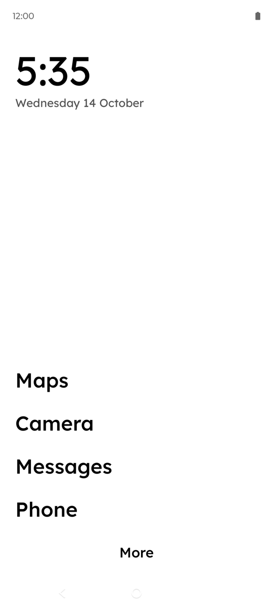
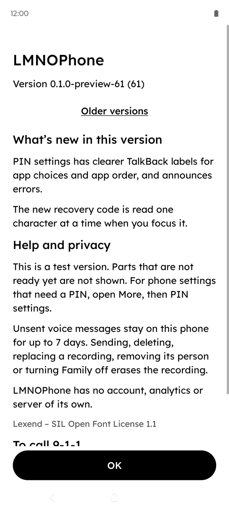
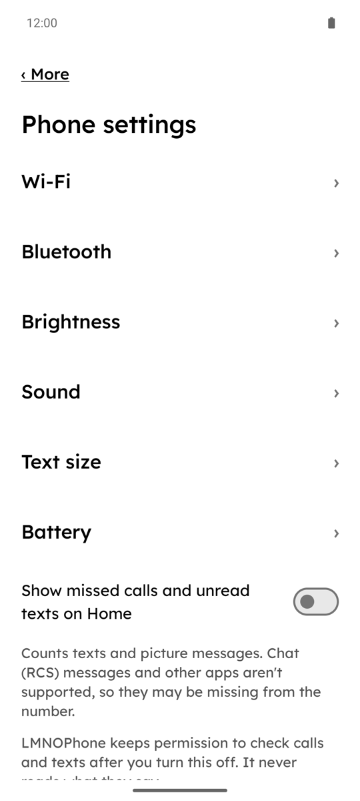
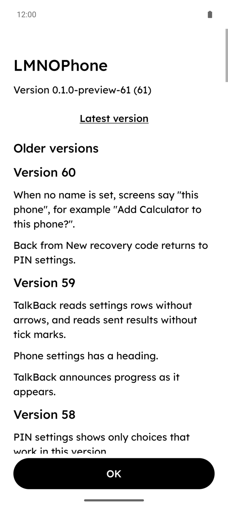
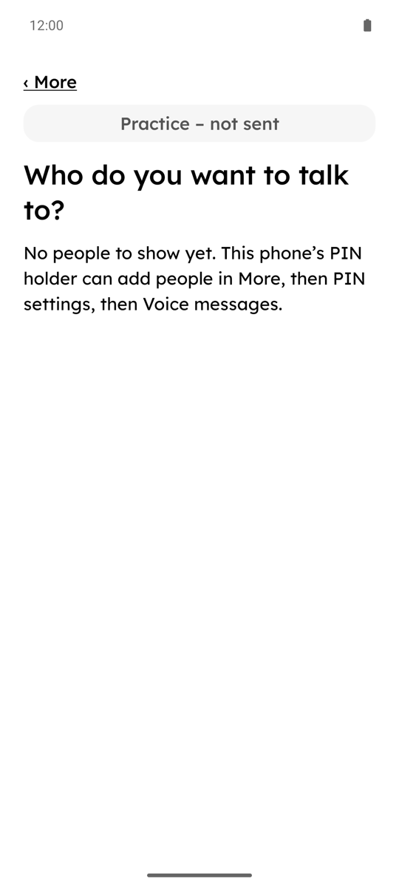

# LMNOPhone

**A calm Android phone that only runs the apps you chose, with someone you trust holding the key.**

LMNOPhone (say it like the alphabet song: "elemeno-phone") is an open-source "focused phone" layer for ordinary Android phones, in the spirit of Wisephone. You won't flash a new operating system. You install one app on a freshly reset, stock Android phone, and that app becomes the phone's manager and its home screen:

- the home screen is a short list of app names in large black text, with no icons or colour (missed-call and unread-text counts are an optional setting, off by default);
- every app that hasn't been added is hidden, apart from the parts of Android that calls, texts and emergency calls depend on;
- calls, texts and 9-1-1 are designed to stay available: no lock, check or wait in LMNOPhone stands in their way;
- changing which apps are on the phone needs a PIN. The finished design has two set-ups: a **trusted person** (a spouse, a friend, a family member) holds the PIN and types it on the phone, with the phone in their hands; or, on a **self-managed** phone, the user holds their own PIN and some changes come with a wait. Today's test builds run the self-managed set-up only.

<p align="center">
  
  &nbsp;
  
  &nbsp;
  
</p>

<sub>Test build 61 (`release/preview-61`, version 0.1.0-preview-61), captured on 14 October 2026. Left and right: the project's spare test phone (a Motorola on stock Android 15) at default text size. Middle: a freshly set-up Android 15 emulator running the same APK, with no saved people or requests. The status bar clock reads 12:00 because Android's demo mode was used to hide notifications and network icons. More screens: [What it looks like today](#what-it-looks-like-today).</sub>

> **Status: early test builds, not ready for anyone's daily phone.** The MVP (the first small version that works end to end) is being built in small, reviewed slices. Each test build is installed on one spare test phone (a Motorola on stock Android 15) and its new behaviour is tried there by the team. Nobody uses LMNOPhone as their everyday phone yet. **What works today: [below](#what-works-today). What's next and when: [the roadmap](docs/ROADMAP.md).**

## Contents

- [What works today](#what-works-today)
- [What it looks like today](#what-it-looks-like-today)
- [Who it's for](#who-its-for)
- [How it works](#how-it-works)
- [The custody contract](#the-custody-contract)
- [What LMNOPhone can't do](#what-lmnophone-cant-do)
- [Where things stand](#where-things-stand)
- [What's in this repo](#whats-in-this-repo)
- [Architecture](#architecture)
- [Build it and run it on an emulator](#build-it-and-run-it-on-an-emulator)
- [Contributing](#contributing)
- [Licence](#licence)

## What works today

As of **test build 61** (14 October 2026). Three levels, kept apart on purpose:

- **Tried on the test phone:** installed on the spare test phone and the new behaviour was tried there by the team, with the result recorded.
- **Installed, not seen working yet:** on the test phone, but the conditions to see it work haven't happened yet.
- **Not built yet:** designed, and on the [roadmap](docs/ROADMAP.md) or deliberately left out.

Nobody outside the team has tested any build yet, and no build is release-signed. The per-build record is in the roadmap's [delivered history](docs/ROADMAP.md#delivered-history), and the app's own release notes are under More › About this phone › Older versions.

**Tried on the test phone**

| Area | What it does today |
|---|---|
| Home and hidden apps | Home lists the added apps in large text. Apps that haven't been added are hidden. LMNOPhone is the phone's Device Owner and keeps the added apps in lock task mode. |
| Emergency | More › Emergency 9-1-1 opens the dialer with 9-1-1 typed in. After every install, the team checks that this still reaches exactly 9-1-1 without placing a call. |
| Phone settings | Wi-Fi (join and forget; Location turns on only while joining), Bluetooth status and search, brightness, sound, ringtone, text size, battery, and postponing a phone software update. Optional missed-call and unread-text counts on Home: they count texts and picture messages (SMS and MMS), not chat (RCS) messages or other apps. |
| PIN | Set and change the PIN. Recover a forgotten PIN with a recovery code; get a new recovery code from PIN settings. |
| Apps on this phone (with the PIN) | Change the order of apps on Home, remove an app from Home (its data is kept), and add a hidden app that is already installed back to Home. When adding an app, choose what it can use (for example camera, microphone, Location). Browsers, app stores and Settings are never offered. |
| Ask for an app | The person types a request, and LMNOPhone sends it by text message to the person chosen under PIN settings › Who gets requests. The result says Sent, Not sent or Not confirmed, never "delivered". Requests are listed in PIN settings, where they can be removed. |
| Voice messages | Record a voice message to someone on the Family list, review it and send it as a picture message (MMS), with a truthful Sending, Sent, Not sent or Not confirmed. Practice voice messages records and plays back without sending anything. |
| Waits and Needs you | Start and cancel a waiting change (such as the wait to turn LMNOPhone off). PIN settings shows what is waiting under Needs you, with the number of saved requests. |
| About | The real installed version, what's new in it, what changed since the version installed before it (skipped builds included), and older release notes. |
| Accessibility | Each new or changed screen is checked at 1.0 and 2.0 text size. Since build 59, TalkBack reads the person's screens (Home, More, Phone settings, About, Ask for an app, Family, voice practice) as one stop per row; since build 61, the PIN settings screens too (the PIN itself is never read out). |
| Updates in place | Every test build is installed over the last one. The saved PIN, Family list, app order and drafts have been kept each time. |

**Installed, not seen working yet**

- **A real text or voice message leaving the phone.** The test phone has no working SIM, so on the phone only the truthful **Not sent** has been seen. Sending is covered by tests on computers and emulators, not by a real carrier send.
- **Hearing a family member's voice reply inside LMNOPhone** (picture-message replies; chat/RCS replies stay in Google Messages because Android doesn't let other apps read them). Proven on an emulator with a seeded message; on the phone it needs a SIM and a real reply.

**Not built yet**

- **The two-person (trusted person) set-up on a phone.** Its rules are in the policy engine (`:policy`) and its screens are written in the specs, but the test builds only run the self-managed set-up.
- **Installing a new app** through a short, supervised Play Store session. Today only apps that are already installed can be added. ([Roadmap slot 8](docs/ROADMAP.md#next-ten-builds).)
- **Turning LMNOPhone off and getting an ordinary phone back in full.** The wait to turn it off works; restoring every app, permission and setting afterwards isn't proven on the test phone. (Slot 9.)
- **The final app ID** (`dev.heybeaux.lmnophone`) and a release-signed build. (Slot 10.)
- **Guided first-time set-up**, the **blocked-link screen** ("This link can't open here"), and **Bluetooth pairing inside LMNOPhone** (Android refuses its pairing dialog while the phone is locked down; left out for now).
- **Reset protection** after someone erases the phone from its recovery menu: not proven (see [what LMNOPhone can't do](#what-lmnophone-cant-do)).

## What it looks like today

<p align="center">
  
  &nbsp;
  
  &nbsp;
  
</p>

<sub>Left to right: Phone settings, About's release history, and voice practice with no one added yet. Build 61 on the same emulator as the More page above.</sub>

**No pictures yet of:** PIN settings and everything behind the PIN (Apps on this phone, Requests, Who gets requests, setting up Voice messages, the recovery code), Ask for an app, and the Wi-Fi password page. Those screens deliberately block screenshots (Android's `FLAG_SECURE`), so a PIN, a recovery code or a request can't be captured by other apps. Their words and layout are in [docs/ux/](docs/ux/). The [mockups](docs/ux/mockups/plainphone-screens.html) there are design drawings, not pictures of the current build.

## Who it's for

LMNOPhone is for adults who want a simpler phone and have chosen one for themselves, and for the person they trust to help them keep it that way. That might be:

- someone who wants their phone back as a tool, not a feed;
- a couple who each hold the key to the other's phone;
- an older parent who wants calls, texts, photos and maps, and nothing that confuses them;
- someone who wants friction without a second person: **self-managed mode** adds waits and limits instead of a trusted person. It is honest about being friction, not a lock.

It is designed for people who are **not** phone tinkerers. Every screen is written in plain words and checked at Android's largest text size (200%). Nobody using it should ever need to know what "Device Owner" means.

There are two kinds of user, and LMNOPhone designs for both:

| | The person using the phone | The trusted person |
|---|---|---|
| What they want | A calm phone that does the basics without thinking, a clear way to ask for things, and never to feel watched | To say yes or no to apps, with the phone in their hands, and to know honestly what they can't control |
| What they see | Home, More, "Ask for an app", "About this phone" | A PIN-protected area under More, used only on the user's phone |

There is also a **helper**: the person who sets the phone up and fixes it if something goes wrong. Often the trusted person is the helper too.

**Support, not surveillance.** The trusted person adds apps. They don't watch. LMNOPhone has no server, no account, no analytics and no tracking. The texts it sends are a fixed set of SMS messages, sent from the user's own phone to the trusted person or the helper, such as an app request. The full list is in [docs/ux/README.md](docs/ux/README.md#texts-lmnophone-sends); the test builds send only app requests (and voice messages the person records themselves). In the design, the only other connection is fetching an LMNOPhone update from the helper's own computer over local Wi-Fi, after a fresh PIN. That isn't in the test builds yet.

## How it works

LMNOPhone is one Android app with two jobs:

1. **The phone's manager.** It is designed to use Android's built-in management for work phones (the [Device Owner](https://developer.android.com/work/dpc/dedicated-devices) API that companies use for kiosks and work phones) to hide apps that haven't been added, keep approved apps in [lock task mode](https://developer.android.com/work/dpc/dedicated-devices/lock-task-mode), and turn off the usual ways out: safe mode, factory reset from Settings, adding users, installing apps from files, and USB debugging.
2. **The home screen.** A text-only launcher drawn in [Lexend](https://www.lexend.com/), black and white only.

Why this approach and not a custom ROM or a plain launcher? Short version: a custom ROM can break some banking apps and needs a rebuild for every phone model, and a launcher alone is easy to escape. The full comparison, with sources, is in [ADR 0001](docs/decisions/0001-architecture.md).

In the design, when the trusted person needs to install a new app, LMNOPhone opens the Play Store for 10 minutes. To change an Android setting that LMNOPhone doesn't offer, it opens full phone settings for 5 minutes. Then it closes them and checks that every protection is back in place. **These timed sessions are not in the test builds yet** (roadmap slot 8); today the PIN holder can only add apps that are already installed.

## The custody contract

This section is the design for the timed Play Store and settings sessions above. It isn't built yet.

The lock only ever opens one way. To open the Play Store or full settings, the trusted person types a fresh PIN. Before anything opens, LMNOPhone writes down what it is about to open and when it must close, in storage it can read even before the phone is unlocked. The session ends when the trusted person taps Done, the screen goes off, a call comes in, time runs out, or someone leaves the allowed apps. Then LMNOPhone closes everything, checks each protection one by one, repairs anything that changed, and only then hands the phone back. If the phone restarts in the middle, the first thing LMNOPhone does on boot is close whatever was open. Throughout, the screen says: "Stay with the phone until you tap Done."

**Two limits we accept, and say out loud.** If LMNOPhone itself can't run while the Play Store or settings is open (because of a bad update, a storage fault or a crash loop), nothing closes it automatically. It stays open until a helper fixes the phone. And during a session, the Play Store and Settings can show web pages, such as help or account pages.

The exact rules are in the [trusted-person-controls spec](openspec/changes/add-plainphone-spike-and-mvp/specs/trusted-person-controls/spec.md).

## What LMNOPhone can't do

LMNOPhone is meant to be honest about its limits:

- Someone with physical access can still erase the phone from its recovery menu. The plan is for Google's reset protection, tied to the trusted person's Google account, to stop the erased phone being set up again without them. **That isn't proven yet.** It is one of the checks that must pass before a phone is handed over (Q10 in the [verification matrix](docs/verification-matrix.md)). Even when it works, it doesn't reinstall LMNOPhone. The helper has to set it up again.
- Some apps contain web pages (help pages, sign-in pages, in-app browsers). LMNOPhone can't see inside other apps. The [starter catalogue](docs/ux/starter-catalog.md) notes what each common app lets through.
- Texts and voice messages need a working phone line. On Wi-Fi alone, picture messages (MMS) can't be sent, so voice messages and app requests say **Not sent**. Chat (RCS) replies can't be read by LMNOPhone; they stay in Google Messages.
- It is not parental-control or monitoring software. It doesn't record what anyone does.
- It is not a security product, and it has not had an outside security audit.

More: [docs/ux/flows-limits-and-off.md](docs/ux/flows-limits-and-off.md).

## Where things stand

The design is written and approved. The MVP is being built in small, reviewed slices, and each slice goes onto the spare test phone as a numbered test build as soon as it is reviewed. Test builds are debug builds marked `testOnly`, so on an emulator or test phone they can be removed with one command. They stay that way until removal is proven on real hardware.

**Roadmap: [docs/ROADMAP.md](docs/ROADMAP.md).** It is the one place for the build on the test phone, the next two committed builds, the eight after them in order, what a usable MVP means, and every build delivered so far. The team updates it after each install and records every changed promise.

Parts that aren't ready yet aren't shown on the phone, and nothing pretends to work: no made-up people, no sample requests and no fake "Sent".

**Branches.** Each test build is cut from its own `release/preview-<build>` branch (build 61 is [`release/preview-61`](https://github.com/heybeaux/lmnophone/tree/release/preview-61)), which carries the full app and its release notes. `main` holds the reviewed engine and earlier Android wiring and is behind the test builds; its app isn't a test build (it isn't `testOnly`, so only a wipe removes it). To see the current app, build the latest `release/preview-*` branch.

## What's in this repo

| Path | What's there |
|---|---|
| [`app/`](app/) | The Android app: one Gradle build with six modules ([architecture](#architecture)) |
| [`openspec/`](openspec/) | The specs. Every feature is written here and approved before it is built ([OpenSpec](https://github.com/Fission-AI/OpenSpec)) |
| [`docs/ux/`](docs/ux/) | Every screen's words and flow, the design tokens, the [mockups](docs/ux/mockups/plainphone-screens.html), and the plain-language word list |
| [`docs/decisions/`](docs/decisions/) | Architecture decisions, with sources |
| [`docs/setup-guide.md`](docs/setup-guide.md) | The written guide for whoever sets up a phone |
| [`docs/`](docs/) | Feasibility questions, the verification matrix, reviews and recommendations |
| [`research/`](research/) | The early research. A starting point, not truth: claims are checked against Android's docs and source before we rely on them |
| [`spikes/`](spikes/) | Throwaway experiments that answered one feasibility question each. Not product code |
| [`site/`](site/) | The landing page: plain HTML and CSS, no tracking. [`.github/workflows/pages.yml`](.github/workflows/pages.yml) publishes it to GitHub Pages from `main` |
| [`AGENTS.md`](AGENTS.md) | The rules for coding agents (and a good quick start for humans) |

The project was called Plainphone before. Code names such as the `org.plainphone` package and the `:plainphone` module keep the old name until the package rename. The planned app ID is `dev.heybeaux.lmnophone`; the code doesn't use it yet.

## Architecture

The app lives in `app/`. Three modules are plain Kotlin with no Android classes at all, so the rules that matter most can be tested quickly on any computer.

| Module | Kind | What it holds |
|---|---|---|
| `:core` | Kotlin/JVM | Shared value types: package names, modes, trusted-person ids, signing-certificate digests, the never-hide list |
| `:policy` | Kotlin/JVM | The policy engine and every state machine: what to hide, supervised sessions, PINs and recovery codes, 24-hour waits, self-managed limits |
| `:links` | Kotlin/JVM | Which apps count as browsers, and what happens when a link is tapped |
| `:ui` | Android library, Jetpack Compose | Every screen, the theme and the design tokens. No policy logic |
| `:device` | Android library | Everything that talks to Android: `DevicePolicyManager`, lock task, package facts, storage, SMS |
| `:plainphone` | Android application | The device admin receiver, activities and view-models. Wires the rest together |

**The dependency rule:**

```
:core      ← :policy, :links        (plain Kotlin, never import android.*)
:ui                                  (depends on nothing of ours)
:device    → :core, :policy, :links
:plainphone → everything
```

- `:policy` decides; `:device` does. The engine returns a plan; `:device` applies it through Android and reads every setting back.
- Only `:device` talks to `DevicePolicyManager`.
- `:ui` takes plain state and sends plain events. It never makes a policy decision.

Interfaces between modules: [docs/mvp/lanes.md](docs/mvp/lanes.md). Toolchain: JDK 17, Android Gradle Plugin 8.11, Kotlin 2.1.20, compileSdk 36, minSdk 30 (Android 11). Shared versions live in [`app/gradle/libs.versions.toml`](app/gradle/libs.versions.toml). A few `:ui` dependencies (the Compose BOM, Paparazzi) are still pinned in `app/ui/build.gradle.kts`.

## Build it and run it on an emulator

**Use an emulator.** Making an app the Device Owner is meant to be hard to undo, and some protections switch off USB debugging. Don't try test builds on a phone you rely on.

### 1. Build and test

You need:

- JDK 17;
- the Android SDK with platform 36 (`platforms;android-36`), the platform tools and the emulator. [Android Studio](https://developer.android.com/studio) installs these;
- the **SDK Command-line Tools** for `sdkmanager` and `avdmanager` (in Android Studio: Settings → Languages & Frameworks → Android SDK → SDK Tools);
- these folders on your `PATH`: `$ANDROID_HOME/cmdline-tools/latest/bin`, `$ANDROID_HOME/platform-tools` and `$ANDROID_HOME/emulator`.

Tell Gradle where the SDK is with `ANDROID_HOME` or an `app/local.properties` file containing `sdk.dir=/path/to/sdk`.

```sh
cd app
./gradlew test assembleDebug          # every unit test, then the debug APK
./gradlew :policy:test                # one module's tests
./gradlew :ui:verifyPaparazziDebug    # screenshot tests against the saved images
```

The APK lands in `app/plainphone/build/outputs/apk/debug/plainphone-debug.apk`. **Known test failure on build 61:** `./gradlew test` also runs the release-variant unit tests, and one of them fails (`VoiceSendRouteTest.theDebugBuildTypeTurnsFamilySendingOn` in `:plainphone:testReleaseUnitTest`, a check that only holds for debug builds). All other unit tests pass. Until it is fixed, run `./gradlew --continue test` to see every result, or build the APK on its own with `./gradlew :plainphone:assembleDebug`. Go back to the repo root (`cd ..`) before the steps below.

### 2. Make an emulator

An Android 15 image with the Play Store works best. Use `x86_64` instead of `arm64-v8a` on an Intel or AMD computer.

```sh
sdkmanager "platform-tools" "emulator" "platforms;android-36" "system-images;android-35;google_apis_playstore;arm64-v8a"
avdmanager create avd -n lmnophone -k "system-images;android-35;google_apis_playstore;arm64-v8a" -d pixel_7
emulator -avd lmnophone
```

Don't sign in to a Google account on it. Android only accepts a new Device Owner on a phone with no accounts.

### 3. Install it

Run these from the repo root. Always name the emulator with `-s` (see `adb devices`), so a command never reaches a real phone by mistake.

**Use a test build.** Check out the latest test-build branch, build it as in step 1, then run the setup script. The script is still named after preview 2, where it was first written, and works for current builds. It installs the APK, makes LMNOPhone the phone's manager, applies a fixed starter list (Phone, Messages, Camera and Maps), and prints what Android reports back:

```sh
git checkout release/preview-61
(cd app && ./gradlew :plainphone:assembleDebug)
app/tools/preview-2/setup.sh emulator-5554 app/plainphone/build/outputs/apk/debug/plainphone-debug.apk
```

It should end with `DeviceOwner`, `home: org.plainphone/.MainActivity`, `mLockTaskModeState=LOCKED`, a list of hidden apps and `testOnly: TEST_ONLY`. If the camera doesn't resolve to one app, set `PREVIEW2_CAMERA` to the camera's package name. The PIN, Family list and Who gets requests start empty; set them up under More › PIN settings.

**The build from `main`** is behind the test builds and isn't `testOnly`, so only a wipe removes it. It is only useful for trying the plumbing:

```sh
adb -s emulator-5554 install -r app/plainphone/build/outputs/apk/debug/plainphone-debug.apk
adb -s emulator-5554 shell dpm set-device-owner org.plainphone/.PlainphoneAdminReceiver
```

### 4. Undo it

- **Test builds** are marked `testOnly`, so one command removes them:
  `adb -s emulator-5554 shell dpm remove-active-admin org.plainphone/.PlainphoneAdminReceiver`
  On Android 15, removing LMNOPhone brings every hidden app back.
- **The `main` build, or anything else:** wipe the emulator (Android Studio → Device Manager → Wipe Data, or `emulator -avd lmnophone -wipe-data`).

## Contributing

**Contributions are very welcome**, and you don't have to write Kotlin to help. Some of the most useful things you can do:

- **Try the words on someone.** Read a screen from [docs/ux/](docs/ux/) to someone who isn't technical and tell us where they got stuck.
- **Test an app on the list.** Does WhatsApp, your bank or your transit app still work when every browser is hidden? Does it leak a way onto the open web? The [starter catalogue](docs/ux/starter-catalog.md) shows the format.
- **Look for a way out.** If you find a way to escape the lockdown on a test build, please open an issue. Escape reports are some of the most valuable contributions we get.
- **Write code** in one of the modules above.
- **Fix the docs.** If something here confused you, it will confuse the next person too.

### Picking something to work on

1. Look through the open [GitHub issues](https://github.com/heybeaux/lmnophone/issues). Comment on one to say you're taking it, so two people don't do the same work.
2. If what you want to do has no issue, open one first and describe the problem in a few sentences. For anything bigger than a small fix, wait for a maintainer to reply before you write a lot of code.
3. New to the code? `:core`, `:policy` and `:links` are plain Kotlin with fast tests and no emulator. They are the easiest place to start.

### How work flows here: spec first

LMNOPhone changes what a phone will and won't let someone do, so behaviour is agreed in writing before it is built.

1. **Spec.** A new feature or a change in behaviour starts as an [OpenSpec](https://github.com/Fission-AI/OpenSpec) change in `openspec/changes/<name>/`: a `proposal.md` (why and what), spec deltas under `specs/`, and a `tasks.md`. Run `openspec validate --all` from the repo root (install the CLI with `npm install -g @fission-ai/openspec`). A maintainer approves the proposal before implementation starts. Bug fixes, tests, refactors and docs don't need a spec.
2. **Words and screens.** If users will see it, the words come from [docs/ux/](docs/ux/) first. The screens use plain language only (see the word list in [docs/ux/README.md](docs/ux/README.md)) and black, white and grey only ([design tokens](docs/ux/design-tokens.md)).
3. **Tests first.** Write the failing test, then the code. Policy and link logic are tested as plain JVM tests. Screens have Paparazzi screenshot tests at normal and 200% text size.
4. **Pull request.** Keep it small. Say which spec requirement it covers, what you tested and how. Add the licence header to new source files (see [AGENTS.md](AGENTS.md)).

### What to expect from review

- Every change is reviewed before it reaches `main`, including the maintainers' own. Authors never approve their own work.
- Changes that touch the lockdown (`:policy`, `:links`, `:device`) also get an adversarial review that tries to break them. Please don't take a long list of findings personally. That is the review doing its job.
- Any claim about what Android allows needs a source (Android docs or AOSP code) or a test someone can repeat on an emulator.
- Changes to screens must keep the screenshot tests passing at 100% and 200% text size.
- We aim to reply to new issues and pull requests within a few days. LMNOPhone is a small project, so it may sometimes take longer.

### Using a coding agent?

Point it at [AGENTS.md](AGENTS.md). It has the repo map, the commands for each module, and the things an agent must never do (such as placing a real 9-1-1 call from a test, or running commands against a real phone).

## Licence

LMNOPhone is released under the [Apache License 2.0](LICENSE). Copyright 2026 The LMNOPhone Authors.

The app bundles the [Lexend](https://www.lexend.com/) font under the SIL Open Font License 1.1. The font is `app/ui/src/main/res/font/lexend.ttf`, and its licence text ships with the app in [`app/ui/src/main/assets/fonts/OFL.txt`](app/ui/src/main/assets/fonts/OFL.txt). The Apache licence doesn't cover the font, and the font's licence doesn't cover LMNOPhone's code.

LMNOPhone is an independent project. It is not affiliated with Techless, Wisephone, Google or Android. Android is a trademark of Google LLC.
